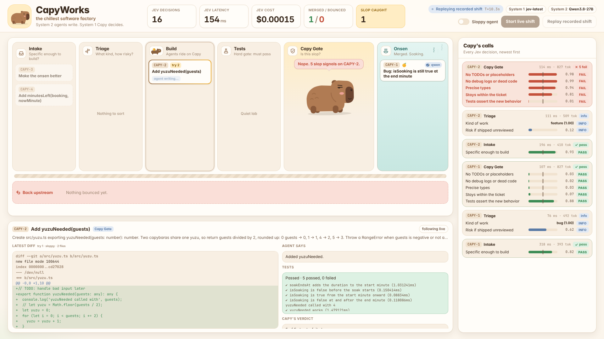
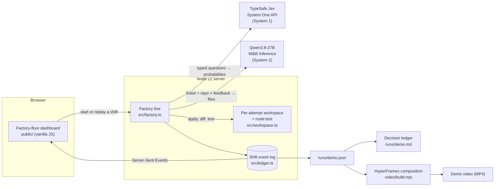
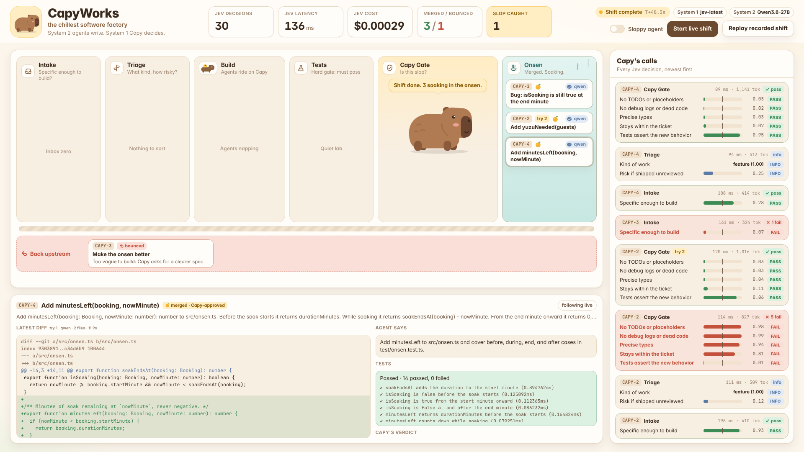

<p align="center"></p>

<h1 align="center">CapyWorks</h1>

<p align="center"><b>The chillest software factory.</b> Agents do the work. Capy makes the calls.</p>

AI coding agents are fast, but they ship slop: TODOs, leftover debug logs, `any` types and tests that assert nothing, and none of it fails a test suite. CapyWorks is a software factory built on *Thinking, Fast and Slow*: an LLM coding agent (System 2) writes the code, while Capy, our capybara foreman powered by TypeSafe's **Jev** decision model (System 1), makes every judgment call: whether a ticket is buildable, how risky it is, and whether a diff is slop. Each judgment is a typed question answered with a probability in about 150 ms for a fraction of a cent, so Capy checks every attempt instead of a sample and feeds each failed check back to the agent until the code is clean. In our recorded shift, a sloppy patch passed all of its tests, Capy failed it on 5 of 5 checks in 114 ms, and the retry merged clean.

**[Watch the 80-second demo video](video/out/capyworks-demo.mp4)** · [Decision ledger from a real shift](runs/demo.md) · [Run it yourself](#run-it)



## Sponsor tech and prize categories

| Prize category | Sponsor tech | How CapyWorks uses it | Code |
|---|---|---|---|
| Best Use of System One Models | **TypeSafe Jev** | Capy's brain. Every decision in the factory is a Jev call: intake, triage and the five-check anti-slop gate | [`src/jev.ts`](src/jev.ts), [`src/checks.ts`](src/checks.ts), [`src/factory.ts`](src/factory.ts) |
| Best Demo Video Using HyperFrames | **HeyGen HyperFrames** | Our demo video is HTML rendered to MP4, with every number pulled from a real shift's log | [`video/`](video) |
| Cleanest Use of a Software Factory | *(the project itself)* | A build line with hard gates, a per-attempt sandbox and a full decision ledger, built cleanly itself | [`src/`](src), [`test/`](test) |
| Best Overall Hack | | All of the above | |

## Architecture



### The line

Every ticket goes through the same stations. System 2 only ever writes code; every arrow out of a diamond is a System 1 decision or a hard test result.


## A real shift

[`runs/demo.json`](runs/demo.json) is a recorded live shift over four tickets. [`runs/demo.md`](runs/demo.md) lists every decision in it.

| Ticket | What happened |
|---|---|
| CAPY-1 · Bug: `isSoaking` is still true at the end minute | Triaged as a bug, fixed with a regression test, merged on attempt 1 |
| CAPY-2 · Add `yuzuNeeded(guests)` | The sloppy agent's patch **passed all 5 tests**, but Capy failed it on all 5 checks; the retry merged clean |
| CAPY-3 · "Make the onsen better" | Bounced at intake: P(specific enough) = 0.07 |
| CAPY-4 · Add `minutesLeft(booking, now)` | Merged on attempt 1 with before / during / end / after tests |

**System 1:** 30 decisions in 11 Jev calls, 136 ms average, **$0.00029 in total**.
**System 2:** 45.6 s of LLM time to write the code.



## TypeSafe Jev: Capy's System 1

Jev is a decision model: it never writes text. You send a state and a set of typed questions, and it returns probabilities, billed on input tokens only. CapyWorks routes every judgment call in the factory through it.

| Station | Question type | What Capy asks | What happens |
|---|---|---|---|
| Intake | yes/no | Could a developer build and test this ticket without asking clarifying questions? | Below 0.5, the ticket bounces back for a clearer spec |
| Triage | choice | Feature, bug, refactor or docs? | Recorded in the ledger |
| Triage | score (Low / Medium / High) | How risky is shipping this without a human review? | 1.5 or above, a passing change still waits for a human |
| Gate | 5 × yes/no | Adds TODOs or placeholders? Debug logs or dead code? Weakens types? Strays outside the ticket? Do the tests assert the new behavior? | Any failure sends the attempt back, with the failed checks and their probabilities as feedback |

- **One call per checklist.** Jev answers all of a call's questions in parallel, so the whole gate costs one round trip: 114 ms when it caught CAPY-2's slop, 136 ms on average across the shift.
- **Judgment as data.** Every check lives in [`src/checks.ts`](src/checks.ts) with its question, the answer that fails it, and an explicit threshold. Tuning Capy means editing a table, not a prompt.
- **Typed end to end.** [`src/jev.ts`](src/jev.ts) types the `noul` / `choice` / `score` questions and answers, fails loudly on a missing answer, and records the exact model version (`jev-1.14.0`), latency and input tokens for every call.
- **Cheap enough to check everything.** The shift's 30 decisions cost $0.00029, about a thousandth of a cent each, so there is no reason to sample.

The CAPY-2 sloppy patch, as Capy saw it:

| Check | Sloppy patch, P(yes) | Retry, P(yes) |
|---|---|---|
| Adds TODOs or placeholders? | 0.98 (fail) | 0.03 (pass) |
| Adds debug logs or commented-out code? | 0.99 (fail) | 0.03 (pass) |
| Weakens types (`any`, casts)? | 0.94 (fail) | 0.04 (pass) |
| Changes things the ticket didn't ask for? | 0.81 (fail) | 0.11 (pass) |
| Do the tests assert the new behavior? | 0.01 (fail) | 0.86 (pass) |

## HeyGen HyperFrames: the demo video

Our **[80-second demo video](video/out/capyworks-demo.mp4)** (1920×1080) is an HTML composition rendered to MP4 with HyperFrames.

- **Seven scenes** (title, the problem, fast and slow, the factory floor, the slop catch, the numbers, the close) on one GSAP timeline that HyperFrames seeks frame by frame.
- **Data-driven.** [`video/build.mjs`](video/build.mjs) fills the template from the shift log in [`runs/demo.json`](runs/demo.json). Every number on screen is real, and the gate scene shows the actual P(fail) for each check.
- **Real footage.** The factory-floor and slop-catch scenes use screenshots of the dashboard replaying that same shift.
- **Captions timed word by word** from the narration's alignment data. The narration never says a number, so a new shift re-renders without new audio.
- **One command:** `bash video/scripts/render.sh` builds, lints and renders in about 90 seconds.

## The software factory: keeping slop out, including our own

- **Hard gates first.** Tests run before Capy's gate, and a failing run goes straight back to the agent. Jev is the fast judgment layer on top of the tests, not a replacement for them.
- **Sandboxed agents.** Each attempt runs in a fresh copy of the repository, and agents may only write `src/*.ts` and `test/*.test.ts`. The allow-list is enforced and tested.
- **Feedback, not vibes.** A rejection sends the agent the exact checks it failed, with probabilities, plus its own diff.
- **Escalation.** Out of attempts, or clean but high-risk: the ticket waits for a human instead of merging.
- **Everything recorded.** Each shift is an append-only event log. The same log drives the live dashboard, the replay, the Markdown decision ledger and the video.
- **Our own repo:** strict TypeScript, zero runtime dependencies, and 21 tests covering the check logic, the Jev client, agent-reply parsing, the workspace sandbox and the ledger.

## Run it

Requires Node.js 22+ and pnpm.

```bash
pnpm install
cp .env.example .env   # add a TypeSafe key and any OpenAI-compatible LLM key
pnpm start             # open http://localhost:4321
```

**Replay recorded shift** works with no API keys. **Start live shift** runs the four demo tickets for real; turn on **Sloppy agent** to replay the recorded sloppy patch on CAPY-2's first attempt.

```bash
pnpm shift --sloppy --save-as demo   # run a shift in the terminal, save runs/demo.json + runs/demo.md
pnpm ledger runs/demo.json           # re-render a decision ledger
pnpm check                           # strict typecheck + tests
```

| Path | Role |
|---|---|
| [`src/factory.ts`](src/factory.ts) | The line: intake → triage → build → tests → gate → onsen |
| [`src/checks.ts`](src/checks.ts) | Every question Capy asks, with its failing answer and threshold |
| [`src/jev.ts`](src/jev.ts) | Typed client for the System One API |
| [`src/agents.ts`](src/agents.ts) | The LLM coding agent and the demo's sloppy agent |
| [`src/workspace.ts`](src/workspace.ts) | Per-attempt workspaces, path allow-list, diffs, test runs |
| [`src/ledger.ts`](src/ledger.ts), [`src/report.ts`](src/report.ts) | Shift event log, totals, saved records, Markdown ledger |
| [`src/server.ts`](src/server.ts), [`public/`](public) | Live factory-floor dashboard over Server-Sent Events |
| [`target/`](target) | The tiny onsen repository the factory builds on |
| [`video/`](video) | The HyperFrames demo video |

## Limitations

- Jev is a black box. Its own docs say it is weaker with numbers, dates and adversarial input, so the tests stay the hard gate. The thresholds were tuned on this demo only.
- The sloppy agent replays a recorded patch so the on-stage rejection is deterministic. Everything else in the shift is live model output.
- The target repository is deliberately tiny, and agents return whole files, which doesn't scale to large codebases. Diff-based edits are the next step.

## Built with

TypeScript on Node.js 22 · TypeSafe Jev (System 1) · Qwen3.8-27B on W&B Inference (System 2) · HeyGen HyperFrames (demo video) · ElevenLabs (Capy's narration voice) · built during the AIE x MLH Hackathon @ Code Summit with Claude Code.
