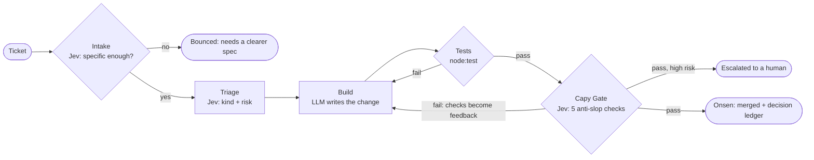

<p align="center"></p>

<h1 align="center">CapyWorks</h1>

<p align="center"><b>The chillest software factory.</b> Agents do the work. Capy makes the calls.</p>

Coding agents are fast, but they ship AI slop: TODOs, leftover `console.log`s, `any` everywhere, tests that assert nothing. **Tests don't catch it.** In our demo, the sloppy patch passes every test.

CapyWorks is a software factory built on *Thinking, Fast and Slow*:

- **System 2 (slow): an LLM coding agent** (Qwen3.8-27B on W&B Inference) writes the code.
- **System 1 (fast): Capy**, powered by [TypeSafe's Jev](https://typesafe.ai) decision model, makes every judgment call. Capy asks typed yes/no, choice and score questions and gets probabilities back in about 100 ms, billed on input tokens only.

Because each decision costs a fraction of a cent and returns faster than a page load, Capy can judge **every** ticket and **every** attempt, not a sample of them.


## The line



1. **Intake** — Capy refuses tickets nobody could build without asking questions.
2. **Triage** — Capy labels the kind of work and scores the risk of shipping it unreviewed. High-risk changes wait for a human even if they pass.
3. **Build** — the LLM gets the ticket, the repo and any feedback, and returns complete files. It may only write `src/*.ts` and `test/*.test.ts`.
4. **Tests** — the hard gate. A failing run goes straight back to the agent.
5. **Capy Gate** — one Jev call asks the whole anti-slop checklist in parallel. Every failed check, with its probability, becomes feedback for the next attempt.
6. **Onsen** — clean code soaks in the hot spring (merged), and Capy gets a yuzu.

## A real shift

[`runs/demo.json`](runs/demo.json) is a recorded live shift over four tickets, rendered in full as a decision ledger in [`runs/demo.md`](runs/demo.md).

| Ticket | What happened |
|---|---|
| CAPY-1 · Bug: `isSoaking` is still true at the end minute | Triaged as a bug, fixed with a regression test, merged on attempt 1 |
| CAPY-2 · Add `yuzuNeeded(guests)` | The sloppy agent's patch **passed all 5 tests** but Capy failed it on all 5 checks; the retry merged clean |
| CAPY-3 · "Make the onsen better" | Bounced at intake: P(specific) = 0.07 |
| CAPY-4 · Add `minutesLeft(booking, now)` | Merged on attempt 1 with before / during / end / after tests |

**System 1:** 30 decisions in 11 Jev calls, 136 ms average, **$0.00029 in total**.
**System 2:** 45.6 s of LLM time to write the code.

The sloppy CAPY-2 patch, as Capy saw it:

| Check | P(yes) | Verdict |
|---|---|---|
| Adds TODOs or placeholders? | 0.98 | fail |
| Adds debug logs or commented-out code? | 0.99 | fail |
| Weakens types (`any`, casts)? | 0.94 | fail |
| Changes things the ticket didn't ask for? | 0.81 | fail |
| Do the tests assert the new behavior? | 0.01 | fail |

The rewrite scored 0.03, 0.03, 0.04, 0.11 and 0.86 on the same questions and merged.

## Run it

Requires Node.js 22+.

```bash
npm install
cp .env.example .env   # add a TypeSafe key and any OpenAI-compatible LLM key
npm start              # open http://localhost:4321
```

**Replay recorded shift** works with no API keys. **Start live shift** runs the four demo tickets for real; tick **Sloppy agent** to replay the recorded sloppy patch on CAPY-2's first attempt.

From the terminal:

```bash
npm run shift -- --sloppy --save-as demo   # run a shift, save runs/demo.json + runs/demo.md
npm run ledger -- runs/demo.json           # re-render a decision ledger
npm run check                              # strict typecheck + tests
```

## How it's built

| Path | Role |
|---|---|
| [`src/factory.ts`](src/factory.ts) | The line: intake → triage → build → tests → gate → onsen |
| [`src/checks.ts`](src/checks.ts) | Every question Capy asks, with its failing answer and threshold, as data |
| [`src/jev.ts`](src/jev.ts) | Typed client for the System One API (`/v1/systemone`) |
| [`src/agents.ts`](src/agents.ts) | The LLM coding agent and the demo's sloppy agent |
| [`src/workspace.ts`](src/workspace.ts) | A fresh workspace per attempt, path allow-list, diffs, test runs |
| [`src/ledger.ts`](src/ledger.ts), [`src/report.ts`](src/report.ts) | Append-only shift log, totals, saved records, Markdown ledger |
| [`src/server.ts`](src/server.ts), [`public/`](public) | Live factory-floor dashboard over Server-Sent Events |
| [`target/`](target) | The tiny onsen repository the factory builds on |
| [`video/`](video) | The demo video, made with HyperFrames and narrated with ElevenLabs |

**Keeping our own factory clean:** strict TypeScript, zero runtime dependencies, and 21 tests covering the check logic, the Jev client, agent-reply parsing, the workspace sandbox and the ledger. Judgment calls live in one data file, not in prompts. Every decision is recorded with its probability, threshold and latency.

## Limitations

- Jev is a black box. Its own docs say it is weaker with numbers, dates and adversarial input, so the tests stay the hard gate and Capy is the fast judgment layer on top. The thresholds were tuned on this demo only.
- The sloppy agent replays a recorded patch so the on-stage rejection is deterministic. Everything else in the demo shift is live model output.
- The target repository is deliberately tiny. Agents return whole files, which doesn't scale to large codebases.

Built in one day at the AIE x MLH Hackathon @ Code Summit, with Claude Code.
